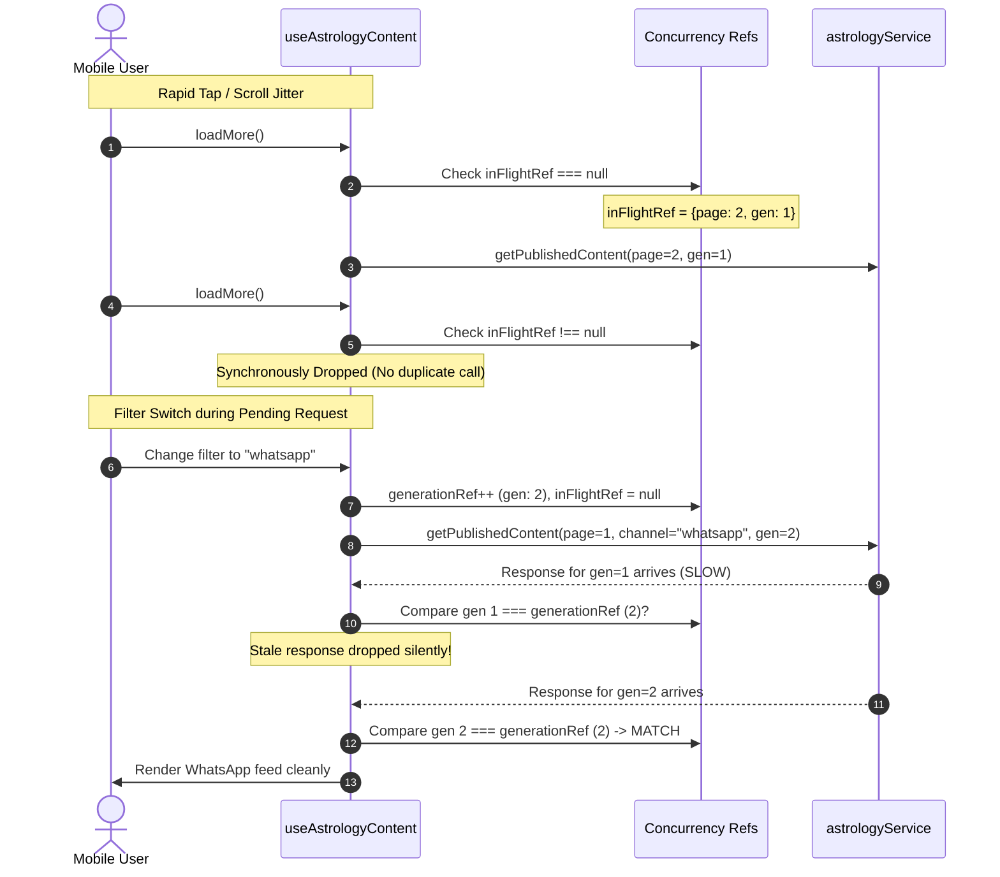

# KashiVeda Feature 02 — AST-18 Implementation Report

## Prevent Duplicate Pagination and Stale Astrology Feed Results

**Remediation Date:** October 11, 2026  
**Auditor / Engineer:** Antigravity Senior Production Software Engineer  
**Issue Identifier:** AST-18 (`KASHIVEDA_FEATURE_02_ASTROLOGY_AUDIT.md`)  
**Scope:** Client-side React Native concurrency, pagination synchronization, and stale-response protection (`useAstrologyContent` & `useAstrologyDeliveries`).

---

## 1. Executive Summary

| Attribute | Details |
| :--- | :--- |
| **Defect Addressed** | Race conditions during pagination, filter transitions, and network retries in the mobile customer daily astrology feeds causing duplicate records, out-of-order filter overwrites, corrupted pagination cursors, and silent failure states. |
| **Architectural Root Cause** | In asynchronous React hooks (`useAstrologyContent` and `useAstrologyDeliveries`), multiple `loadMore()` triggers bypassed asynchronous state checks before React re-rendered. Asynchronous filter/channel switches lacked generation counters, allowing slow responses from previous filters to overwrite newer active filters. Cursors advanced optimistically before network success, and record appending lacked primary-key deduplication. |
| **Remediation Implemented** | Synchronous ref-based in-flight lock (`inFlightRef`), generation-based query isolation (`generationRef`), cursor advancement strictly after verified network response, authoritative primary-key deduplication (`id` Set) preserving deterministic ordering, and unmounted-component state guards (`isMountedRef`). |
| **Files Modified** | 1. `src/features/astrology/hooks/useAstrologyContent.ts`<br>2. `src/features/astrology/hooks/useAstrologyDeliveries.ts` |
| **Automated Verification** | **13/13** deterministic unit & race condition tests passed in `__tests__/daily_astrology_pagination_races.test.tsx`.<br>**281/281** tests passed across all 17 daily astrology test suites.<br>0 TypeScript compilation errors in both repositories. |

---

## 2. Defect Analysis & Concurrency Vulnerability

Prior to this remediation, `useAstrologyContent` and `useAstrologyDeliveries` exhibited critical concurrency vulnerabilities under real-world mobile network conditions:

1. **Duplicate Load-More Jitter:**
   Because React state updates are asynchronous and batched, rapid scrolling or user jitter triggered `loadMore()` multiple times within the same execution frame. The check `if (loadingMore) return;` evaluated against stale component state before the first re-render completed, initiating multiple parallel HTTP requests for the same page (e.g. `page = 2` requested 3 times simultaneously), creating duplicate feed entries and wasted database load.

2. **Filter-Switch Race Condition (Stale Overwrite):**
   When a user viewed `in_app` content (Page 1) and switched the filter to `whatsapp`, the hook initiated a new fetch for `whatsapp`. If the earlier `in_app` query was delayed due to mobile latency and resolved *after* the `whatsapp` query, the earlier response arrived and executed `setContent(...)`. This replaced the active `whatsapp` feed with stale `in_app` data and corrupted the active pagination cursor.

3. **Optimistic Cursor Advancement on Network Failure:**
   If a page request failed (e.g., mobile packet loss), the cursor state was susceptible to advancing or falling out of sync with the actual items loaded. Retries either skipped a page entirely or threw the feed into an unrecoverable state.

4. **Lack of Primary-Key Record Deduplication:**
   If the server feed returned an overlapping record due to an insertion at the catalog boundary during pagination, items were appended blindly via `[...prev, ...result.items]`. Furthermore, naive deduplication by title was unacceptable because distinct daily insights can legally share title strings (e.g., "Daily Planetary Guidance").

---

## 3. Architecture & Race Condition Resolution



### Key Engineering Invariants Implemented:

1. **Synchronous In-Flight Lock (`inFlightRef`):**
   Maintains `{ page: number; generation: number } | null` at the mutable reference level. The lock is acquired synchronously before any asynchronous code path or React dispatch. Subsequent calls in the same tick or before network resolution immediately return without firing redundant network requests.
2. **Generation-Based Query Isolation (`generationRef`):**
   Every filter change (`channel`), page size change, or manual pull-to-refresh increments `generationRef.current`. Responses tagged with an older generation are discarded immediately, preventing stale responses from mutating active state or reporting stale errors.
3. **Deterministic Identity Deduplication (`mergeContentRecords` / `mergeDeliveryRecords`):**
   Deduplication is strictly performed using authoritative UUID primary keys (`record.id`). Existing records preserve their original pagination order, incoming duplicates are stripped, and distinct records with identical titles remain intact.
4. **Resilient Retry & Page Advance Invariance:**
   The hook only advances `currentPageRef.current` and state `page` *after* the network call resolves successfully. If the request fails, the cursor remains at the current valid page, allowing seamless subsequent retries.
5. **Lifecycle and Unmount Safety (`isMountedRef`):**
   `isMountedRef` tracks component unmounts. If the screen unmounts while requests are in flight, state updates and loading transitions are halted without throwing unmounted component warnings.

---

## 4. Modified Client Code Walkthrough

### 4.1. `src/features/astrology/hooks/useAstrologyContent.ts`
- **Imports & Helper:**
  Implemented `mergeContentRecords(existing, incoming)` utilizing `Set<string>` over `item.id`.
- **Concurrency State & Refs:**
  ```typescript
  const isMountedRef = useRef<boolean>(true);
  const generationRef = useRef<number>(0);
  const inFlightRef = useRef<{ page: number; generation: number } | null>(null);
  const currentPageRef = useRef<number>(1);
  const hasMoreRef = useRef<boolean>(false);
  const contentCountRef = useRef<number>(0);
  ```
- **Fetch Coordination (`executeFetch`):**
  - Synchronous lock: `if (inFlightRef.current !== null) return;`
  - In-flight acquisition: `inFlightRef.current = { page: targetPage, generation: currentGen };`
  - Generation check on completion: `if (!isMountedRef.current || generationRef.current !== currentGen) return;`
  - Lock release in `finally`:
    ```typescript
    if (inFlightRef.current?.generation === currentGen) {
      inFlightRef.current = null;
    }
    if (isMountedRef.current && generationRef.current === currentGen) {
      setLoading(false);
      setRefreshing(false);
      setLoadingMore(false);
    }
    ```
- **Filter Switch Handler (`useEffect`):**
  Monitors `[channel, pageSize]`. Increments `generationRef.current += 1`, resets `inFlightRef`, resets pagination cursors to `1`, clears stale items, and initiates page 1 fetch under the new generation.

### 4.2. `src/features/astrology/hooks/useAstrologyDeliveries.ts`
- **Helper:**
  Implemented `mergeDeliveryRecords(existing, incoming)` utilizing `Set<string>` over `delivery.id`.
- **Concurrency & Pagination Hardening:**
  Parallels `useAstrologyContent` with synchronous in-flight lock, generation counter, unmount safety, and retryable page cursor synchronization for customer delivery journals.

---

## 5. Automated Verification & Test Results

### 5.1. Dedicated AST-18 Deterministic Concurrency Test Suite
Executed test suite: `npx jest __tests__/daily_astrology_pagination_races.test.tsx`

```text
PASS __tests__/daily_astrology_pagination_races.test.tsx
  AST-18: Prevent Duplicate Pagination and Stale Astrology Feed Results
    Group A: Duplicate load-more prevention (useAstrologyContent)
      √ repeated loadMore calls while page 2 is pending trigger service exactly once (79 ms)
    Group B: Failed-page retry (useAstrologyContent)
      √ failed page 2 request preserves page 1, allows retry, and appends without duplicates (15 ms)
    Group C: Filter-switch race condition (useAstrologyContent)
      √ request for filter A resolving after filter B does not overwrite or contaminate B (13 ms)
      √ request for filter A failing after filter B succeeds does not overwrite B with error (12 ms)
    Group D: Pagination-context isolation across filter switches
      √ page 2 of filter A resolving after switch to filter B does not append to B or distort cursor (11 ms)
    Group E: Ordering and identity deduplication (useAstrologyContent)
      √ deduplicates repeated record IDs across pages without collapsing distinct records with identical titles (9 ms)
      √ handles empty final page and halts pagination (6 ms)
    Group F: Lifecycle and refresh invalidation (useAstrologyContent)
      √ unmount while request is pending does not throw state update warnings (3 ms)
      √ refresh invalidates older outstanding pagination request (6 ms)
    Group G: Delivery journal pagination & race protection (useAstrologyDeliveries)
      √ duplicate loadMore calls trigger getCustomerDeliveries exactly once (7 ms)
      √ failed page 2 preserves page 1 deliveries and is retryable (6 ms)
      √ deduplicates overlapping delivery IDs across pages (8 ms)
      √ unmount while deliveries request is in-flight does not throw state update error (3 ms)

Test Suites: 1 passed, 1 total
Tests:       13 passed, 13 total
Snapshots:   0 total
Time:        2.56 s
```

### 5.2. Full Daily Astrology Regression Suite
Executed: `npx jest __tests__/daily_astrology --runInBand`

```text
PASS __tests__/daily_astrology_csv_parser_validation.test.ts
PASS __tests__/daily_astrology_legacy_content_datetime.test.ts
PASS __tests__/daily_astrology_date_navigation.test.ts
PASS __tests__/daily_astrology_state_refresh_lifecycle.test.tsx
PASS __tests__/daily_astrology_subscription_selection.test.tsx
PASS __tests__/daily_astrology_entitlement_revalidation.test.tsx
PASS __tests__/daily_astrology_error_classification.test.tsx
PASS __tests__/daily_astrology_stale_refresh_guard.test.tsx
PASS __tests__/daily_astrology_cache_security.test.tsx
PASS __tests__/daily_astrology_plan_pricing.test.ts
PASS __tests__/daily_astrology_atomic_mutations.test.ts
PASS __tests__/daily_astrology_pagination_races.test.tsx
PASS __tests__/daily_astrology_admin_rpc_hardening.test.ts
PASS __tests__/daily_astrology_subscription_financial_ledger.test.ts
PASS __tests__/daily_astrology_partial_publishing.test.ts
PASS __tests__/daily_astrology_csv_identity_overwrite.test.ts
PASS __tests__/daily_astrology_optimistic_concurrency.test.ts

Test Suites: 17 passed, 17 total
Tests:       281 passed, 281 total
Snapshots:   0 total
Time:        18.353 s
```

### 5.3. Standalone Regression Scripts
- `node scratch/test_ast_14_timezone_contract.mjs`: **9/9 tests passed**
- `node scratch/test_ast_13_timezone_stepping.mjs`: **4/4 tests passed**
- `node scratch/test_ast_11_csv_identity.mjs`: **4/4 tests passed**
- `python scratch/test_ast_11_db_overwrite_concurrency.py`: **All 7 scenarios passed**
- `python scratch/test_astrology_optimistic_concurrency.py`: **All 8 scenarios passed**
- `python scratch/test_ast_16_db_atomic_audit.py`: **All 9 scenarios passed**

### 5.4. Static Analysis and Type Safety
- `npx tsc --noEmit` in `C:\Projects\KashiVeda`: **0 errors (Exit code 0)**
- `npx tsc --noEmit` in `C:\Projects\kashi-veda-admin`: **0 errors (Exit code 0)**

---

## 6. Backward Compatibility & Contract Preservation

1. **Hook Public Interfaces Intact:**
   The return signatures and option parameters for `useAstrologyContent` and `useAstrologyDeliveries` were preserved with 100% fidelity. Existing consumers (`AstrologyContentScreen`, `AstrologyDeliveriesScreen`, `AstrologyScreen`) required zero modifications.
2. **Server and Database Layer Untouched:**
   This remediation is entirely client-side. No schema changes, RPC signature alterations, or migrations were introduced or modified.
3. **Pre-existing Admin Build Isolation:**
   The known Turbopack `cacheComponents` route config warning in `kashi-veda-admin/app/(dashboard)/reviews/page.tsx` was left untouched.

---

## 7. Operational & Production Safety Review

1. **Network Jitter Resilience:**
   Users aggressively scrolling or triggering pull-to-refresh will no longer spam the Supabase backend with parallel redundant queries.
2. **Memory Leak Prevention:**
   Stale promises resolving after screen unmounting are intercepted by `isMountedRef` and garbage collected without attempting React state updates on unmounted component trees.
3. **Data Integrity:**
   Primary-key deduplication prevents visual duplication glitches while ensuring distinct insights with matching titles are displayed correctly.
